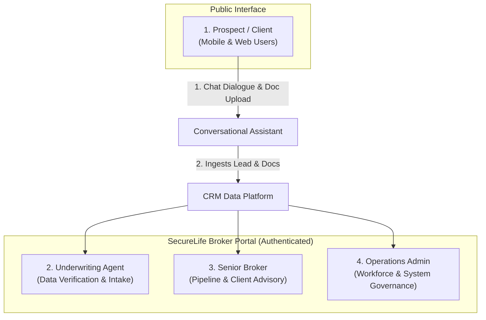
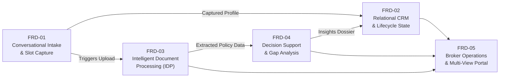
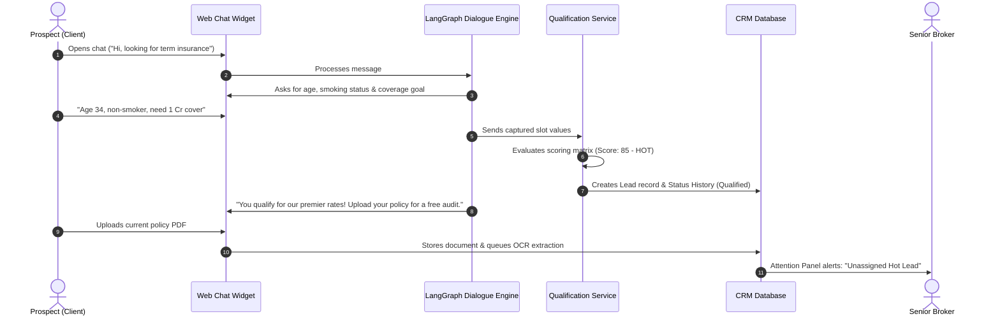
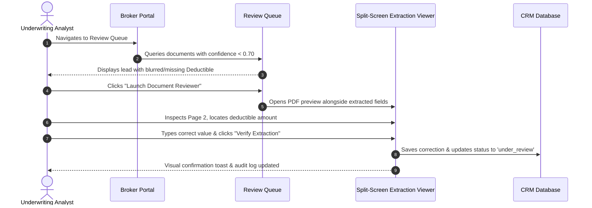

# SecureLife Intelligent Lead Pipeline: Functional Overview

## 1. Product Vision & Executive Summary

The **SecureLife Intelligent Lead Pipeline** is an end-to-end insurance qualification, client relationship management (CRM), and document intelligence platform designed specifically for modern insurance brokerages.

In traditional insurance brokerages, onboarding a new prospect is slow, labor-intensive, and fragmented:
* A prospective client fills out a static form or emails an inquiry.
* An agent manually exchanges phone calls or emails to gather family, health, and budget details.
* The client emails scanned copies or photos of their existing policy declarations and claim records.
* An underwriting analyst manually reads through 10–30 page policy schedules to find coverage limits, deductibles, and exclusions.
* A senior broker manually computes rate differences and prepares a recommendation.
* **Average turnaround time**: **2 to 3 business days per lead.**

**SecureLife eliminates this friction** by deploying an automated, conversational AI intake assistant, an intelligent document processing (IDP) engine, and an actuarial decision-support engine:
$$\text{Conversational Intake} \longrightarrow \text{Rule Qualification} \longrightarrow \text{OCR Extraction} \longrightarrow \text{Gap Analysis} \longrightarrow \text{Broker Dossier}$$
* **New turnaround time**: **Under 15 minutes from document upload to broker-ready presentation.**

---

## 2. Target Personas & Functional Roles

The system serves four primary user personas across public and authenticated interfaces:

| Persona | Functional Capabilities & Day-to-Day Responsibilities |
|---|---|
| **Prospect / Client** | Interacts with the AI advisor on the public website; discusses insurance goals in plain language; provides budget and family attributes; uploads existing policy schedules or renewal notices; consents to broker contact. |
| **Senior Broker** *(e.g., Rajesh Sharma)* | Monitors the high-level conversion pipeline; prioritizes Hot Leads ($\text{Score} \ge 80$); reviews automated coverage gap and savings analyses; contacts qualified prospects with data-backed talking points; updates deal statuses to Closed Won. |
| **Underwriting Agent** *(e.g., Pooja Verma)* | Focuses on the **Review Queue** workspace; audits extracted policy declarations; verifies flagged low-confidence values ($< 0.70$) using side-by-side PDF preview; adds internal underwriting notes. |
| **Operations Admin** *(e.g., Vikram Mehta)* | Manages broker accounts and role permissions; reassigns unassigned leads across team members; inspects funnel drop-off metrics to optimize conversion rates. |

---

## 3. Core Functional Domains (FRD-01 to FRD-05)

The platform is structured into **five autonomous functional domains**, each mapping to a crucial stage of the insurance sales and underwriting lifecycle:

---

### Domain 1: Conversational Intake & Dynamic Slot Capture (FRD-01)
* **Natural Dialogue vs. Rigid Forms**: Prospects interact with an empathetic conversational agent rather than filling out multi-step web forms. The assistant handles interruptions, tangential questions, and conversational corrections smoothly.
* **Information Extraction (Slots)**: Without feeling interrogative, the agent extracts:
  * Insurance interest (Term Life, Health, Motor, Commercial, Home).
  * Existing coverage status and current provider (e.g., HDFC Life, Star Health, ICICI Lombard).
  * Household scale, age range, and employment status.
  * Annual premium budget and target renewal timeframe.
  * Contact channel preference (Phone vs. Email) and formal consent.
* **Needs-Human Detection**: The conversational engine automatically detects high-intent prospects or complex edge cases (e.g., *"My husband was hospitalized last week, we urgently need health cover"*) and immediately flags `needs_human: true` for priority broker callback.

---

### Domain 2: Deterministic Lead Qualification & CRM Data Layer (FRD-02)
* **Deterministic Rule Scoring**: Lead scores ($0\text{--}100$) are calculated by a pure mathematical rules engine—never hallucinated by language models:
  $$\text{Score} = \text{Interest Match (30 pts)} + \text{Existing Policyholder (20 pts)} + \text{Renewal Proximity (20 pts)} + \text{Budget Match (15 pts)} + \text{Household Scale (15 pts)}$$
* **Automated Tiering**:
  * 🔥 **Hot Lead ($\ge 80$ pts)**: Immediate broker assignment and instant notification.
  * ⚡ **Warm Lead ($50\text{--}79$ pts)**: Standard priority queue; invites document upload.
  * ❄️ **Cold Lead ($< 50$ pts)**: Polite automated nurturing or out-of-guidelines disqualification.
* **Immutable Audit Ledger**: Every status shift (e.g., `in_conversation` $\to$ `qualified` $\to$ `under_review`) is permanently stored with an actor ID, reason code, and timestamp.

---

### Domain 3: Intelligent Document Processing (IDP) & OCR (FRD-03)
* **Multi-Format Ingestion**: Accepts PDF declarations, multi-page renewal notices, and smartphone camera photos (`PNG`, `JPEG`, `PDF`) up to 20 MB with SHA-256 deduplication.
* **Automated Field Extraction**: Extracts standard insurance entities into a structured schema:
  * Insurer / Carrier Name
  * Policy Schedule Number & Policy Type
  * Sum Insured / Coverage Limits
  * Annual & Monthly Premium Breakdown
  * Deductibles, Co-pays & Room Rent Caps
  * Policy Effective Date & Renewal Expiration
  * Specific Endorsements & Exclusions
* **Confidence Scoring & Evidence popovers**: Every extracted field receives a confidence rating ($0.00\text{--}1.00$). Brokers can hover over any extracted field to see the exact bounding box and source text on the original PDF page.
* **Broker Review Queue & Inline Editor**: If a document has overall confidence $< 0.70$ or missing key values, it is placed in the Review Queue. Brokers can view a side-by-side split-screen PDF preview and perform one-click inline corrections.

---

### Domain 4: Underwriting Decision Support & Gap Analysis (FRD-04)
* **Automated Coverage Gap Detector**: Cross-references the prospect's extracted policy schedule against standard actuarial benchmarks for their family size, location, and income bracket:
  * Detects inadequate health sum insured (e.g., ₹5 Lakh coverage for a family of 4 in a Tier-1 metro).
  * Highlights missing riders (e.g., Critical Illness, Accidental Disability, Zero Depreciation on motor).
  * Flags restrictive room-rent caps or high co-pay clauses.
* **Premium Savings Calculator**: Calculates concrete financial savings by comparing current annualized premiums against negotiated broker partner rates:
  $$\text{Potential Annual Savings} = \text{Existing Premium} - \text{Recommended Benchmark Rate}$$
* **Executive Broker Dossier**: Generates an actionable briefing with talking points, risk highlights, and a recommended alternative policy product ready for the broker to present.

---

### Domain 5: Broker Operations & Multi-View CRM Workspace (FRD-05)
* **Collapsible Enterprise Sidebar**:
  * **Pipeline Dashboard**: High-level visual workflow tracking.
  * **Leads Directory**: Full search, filtering, and pagination CRM table.
  * **Review Queue**: Operational workspace for unverified and low-confidence documents.
  * **Public Site Preview**: Instant link to test the prospect-facing conversational widget.
* **Pipeline View Modes**:
  * **Kanban Board**: Drag-and-drop cards across 6 operational columns with score badges, assignee avatars, and document attachment counts.
  * **Funnel Chart**: Visual conversion funnel tracking drop-off across lifecycle milestones ($\text{Total} \to \text{Qualified} \to \text{Docs Uploaded} \to \text{Under Review} \to \text{Won}$).
  * **Compact Table**: High-density view for rapid batch operations.
* **Global Attention Panel**: Proactively highlights urgent tasks:
  * Unassigned Hot Leads awaiting initial outreach.
  * Documents awaiting underwriting review.
  * Policies renewing within 30 days.
* **Lead Detail Workspace**: Comprehensive tabbed view providing:
  * **Journey Timeline**: Chronological audit trail connecting chat, scoring, document extraction, status changes, and notes.
  * **Conversation Transcript**: Read-only bubble transcript of the prospect's chat with extracted slot chips.
  * **Documents Tab**: Upload zone, document list, PDF viewer, and extraction editor.
  * **Overview & Notes**: Insurance profile, risk attributes, and internal team notes.

---

## 4. End-to-End Functional User Workflows

### Workflow 1: Prospect Self-Service Intake to Broker Handoff

---

### Workflow 2: Analyst Review & Document Verification

---

## 5. Summary of Business Value & Functional ROI

| Operational Metric | Legacy Manual Process | SecureLife Intelligent Pipeline | Measurable Impact |
|---|---|---|---|
| **Lead Qualification Time** | 4 to 8 hours (manual phone calls) | **Instantaneous** (during conversational chat) | **100% real-time qualification** |
| **Document Data Extraction** | 3 to 6 hours per policy schedule | **Under 15 seconds** (automated OCR + LLM) | **95% reduction in manual data entry** |
| **End-to-End Dossier Preparation** | 2 to 3 business days | **Under 15 minutes** after document upload | **90% faster lead-to-quote turnaround** |
| **Data Accuracy & Traceability** | Handwritten notes and spreadsheets | Single source of truth with immutable audit trails | **Zero lost leads, 100% compliance auditability** |
| **Broker Team Productivity** | 10–15 active leads per broker | **50+ active leads per broker** | **3x to 4x increase in broker capacity** |
