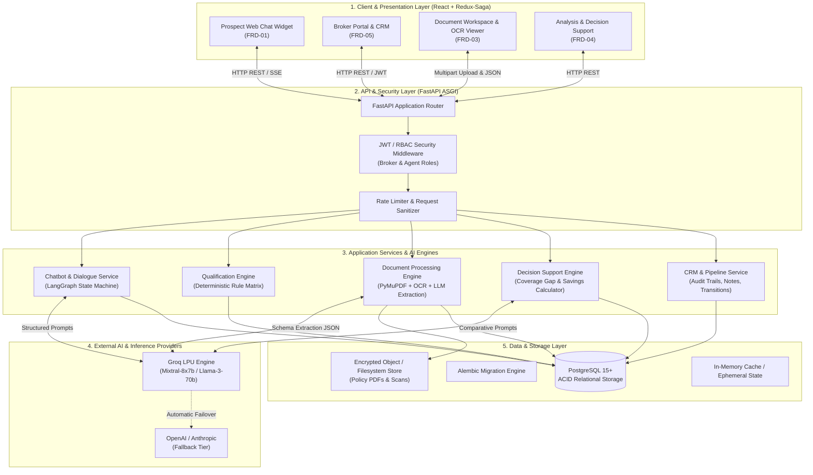
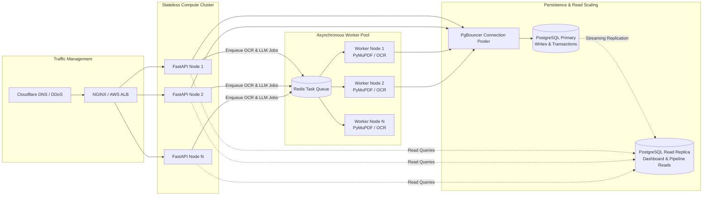

# SecureLife Intelligent Lead Pipeline: System Design & Scalability Architecture

## Executive Summary

The **SecureLife Intelligent Lead Pipeline** transforms a traditional, high-friction insurance brokerage workflow (averaging 2–3 days per lead) into an automated, AI-augmented operational engine delivering broker-ready underwriting dossiers in under 15 minutes.

This document outlines the end-to-end system design, component responsibilities, data lifecycle, and scalability engineering required to support high-throughput prospect intake and document processing across thousands of concurrent sessions.

---

## 1. High-Level System Architecture

The architecture follows a modern, decoupled layered pattern separating conversational presentation, asynchronous workflow orchestration, deterministic business logic, and relational persistence.



---

## 2. Core Subsystems & Component Design

### 2.1 Conversational Lead Intake & Qualification (FRD-01)
* **Goal**: Collect prospective insurance attributes (coverage interest, current provider, premium budget, renewal timeline) without static, low-converting forms.
* **Architecture**:
  * **LangGraph StateGraph**: A directed cyclic graph managing conversational state, slot fulfillment (`LeadCaptureSlots`), clarification loops, and automated handoff.
  * **Deterministic State Transitions**:
    ```mermaid
    stateDiagram-v2
        [*] --> Greet
        Greet --> CollectProfile: User Inquires
        CollectProfile --> ClarifyMissing: Missing Required Slots
        ClarifyMissing --> CollectProfile: User Provides Info
        CollectProfile --> CalculateScore: All Core Slots Captured
        CalculateScore --> OfferDocUpload: Score >= 50 (Qualified)
        CalculateScore --> PoliteDisqualification: Score < 50
        OfferDocUpload --> RouteToBroker: Handoff Triggered
        RouteToBroker --> [*]
    ```
  * **Deterministic Scoring Engine (`qualification_service.py`)**:
    * LLMs are strictly prohibited from calculating lead scores to avoid mathematical hallucination.
    * The scoring matrix awards deterministic point weights:
      $$\text{Score} = \text{Interest}(30) + \text{Policyholder}(20) + \text{Renewal Proximity}(20) + \text{Budget Match}(15) + \text{Household Scale}(15)$$
    * **Tiers**: Hot ($\ge 80$), Warm ($50\text{--}79$), Cold ($< 50$).

### 2.2 Relational CRM & Pipeline Architecture (FRD-02 & FRD-05)
* **Goal**: Centralized single source of truth across all prospect interactions, notes, documents, and audits.
* **Database Models (`backend/app/db/models.py`)**:
  * `Lead`: Primary record tracking contact info, qualification score, tier, and status.
  * `LeadStatusHistory`: Append-only immutable ledger tracking status transitions, timestamps, actor ID, and reason codes.
  * `LeadNote`: Internal broker collaboration thread with author references.
  * `LeadMessage`: Raw dialogue transcript preserving human-bot chat turns for auditability.
  * `User`: Internal staff (Brokers and Agents) with role-based permissions.
* **Ten-Stage CRM State Machine**:
  $$\text{New} \to \text{In Conversation} \to \text{Qualified} \to \text{Docs Pending} \to \text{Docs Processing} \to \text{Under Review} \to \text{Analysis Complete} \to \text{Closed Won / Closed Lost / Disqualified}$$

### 2.3 Intelligent Document Processing (IDP) Pipeline (FRD-03)
* **Goal**: Ingest real-world policy declarations, certificates of insurance, and renewal schedules (including scanned or skewed documents).
* **Execution Flow**:
  1. **Upload & Validation**: Enforces MIME validation (`application/pdf`, `image/png`, `image/jpeg`), 20 MB size limits, and SHA-256 deduplication.
  2. **Page Rasterization (`PyMuPDF`)**: High-fidelity rendering of PDF pages to image buffers at 200 DPI.
  3. **OCR Extraction & Text Normalization**: Extracts raw text blocks alongside coordinate bounding boxes.
  4. **Structured LLM Extraction (`Pydantic v2`)**: Passes normalized text blocks to LLM with an enforced JSON schema (`PolicyExtractionSchema`):
     * Insurer / Carrier name
     * Policy type & Policy number
     * Sum insured / Coverage limits
     * Annual / Monthly premium
     * Deductible & Copay structures
     * Policy effective & expiration dates
     * Exclusions & Special endorsements
  5. **Confidence Scoring Engine**: Computes field-level and overall document confidence:
     $$\text{Confidence}_{\text{doc}} = \frac{1}{N} \sum_{i=1}^N w_i \cdot c_i$$
     Documents with overall confidence $< 0.70$ or missing core fields are routed directly to the Broker **Review Queue**.

### 2.4 Intelligent Analysis & Decision Support (FRD-04)
* **Goal**: Transform extracted policy schedules into competitive advantages for brokers.
* **Analytical Modules**:
  * **Coverage Gap Detector**: Compares current policy limits against actuarial benchmarks for the client's family size and income tier (e.g., identifies inadequate critical illness sub-limits or missing water backup endorsements).
  * **Savings Calculator**: Compares current annualized premium with negotiated benchmark partner rates to compute concrete savings potential:
    $$\text{Savings} = \text{Current Premium} - \text{Recommended Rate}$$
  * **Risk Scorer**: Evaluates policy lapse hazards, high deductibles relative to income, and restrictive exclusion clauses on a normalized 0–100 scale.
  * **Executive Broker Brief**: Generates structured talking points and ready-to-pitch alternative policy recommendations.

---

## 3. Scalability Architecture



### 3.1 Stateless Compute & Horizontal Scaling
* **FastAPI Application Nodes**: The backend contains zero local in-memory session dependencies. User authentication is stateless via cryptographically signed JWT tokens (`HS256` or `RS256`).
* **Auto-Scaling Policy**:
  * Metric: CPU Utilization $> 70\%$ or Average Request Latency $> 250\text{ ms}$.
  * Scale-out duration: $< 30\text{ seconds}$ via containerized Docker images on ECS/Kubernetes.
* **Vite React Frontend**: Compiled into immutable static bundles (`HTML/CSS/JS`) deployed across Global Edge CDNs (Cloudflare / AWS CloudFront), yielding near-zero compute load on origin servers.

### 3.2 Asynchronous Document Ingestion & Task Offloading
* **Problem**: PDF rasterization and multi-page LLM schema extraction require between $2\text{s}$ and $8\text{s}$ per document. Running this synchronously inside web request threads would cause thread starvation and gateway timeouts.
* **Solution**:
  1. File upload returns an immediate `202 Accepted` with a document tracking ID.
  2. The document processing task is placed on an asynchronous queue (backed by Redis / Celery / ARQ).
  3. Worker processes isolate CPU-bound tasks (PyMuPDF rendering, Tesseract OCR) away from the web-serving event loop.
  4. The web client tracks progress via Redux polling or Server-Sent Events (SSE) updates.

### 3.3 Database Scaling & Connection Management
* **Connection Pooling (`PgBouncer`)**:
  * FastAPI's asynchronous SQLAlchemy engine maintains a lightweight local pool (`pool_size=20`, `max_overflow=10`).
  * In multi-node production clusters, a dedicated `PgBouncer` layer operates in transaction pooling mode, enabling 50+ application pods to share 100 physical PostgreSQL backend connections without connection starvation.
* **Read-Write Separation**:
  * **Primary DB**: Serves mutations, status transitions, chat message logs, and document corrections.
  * **Read Replica**: Offloads read-heavy operations including Kanban pipeline aggregation (`/dashboard/pipeline`), executive KPI counters (`/dashboard/summary`), and paginated leads directory searches (`/leads`).
* **Indexing Strategy**:
  * Composite index on `leads(tenant_id, status)` for instant Kanban column grouping.
  * Composite index on `leads(tenant_id, qualification_tier, qualification_score DESC)` for priority queue sorting.
  * Trigram index (`gin_trgm_ops`) on `leads(full_name, email, phone)` supporting sub-millisecond debounced fuzzy searches across millions of rows.

### 3.4 Multi-Tenancy & Data Isolation
* SecureLife is designed with enterprise multi-tenancy as a core architectural primitive:
  * Every table (`leads`, `documents`, `analyses`, `users`, `notes`) includes a indexed `tenant_id` column.
  * Application-layer dependency injection enforces tenant boundary scoping on every query:
    ```python
    query = db.query(Lead).filter(Lead.tenant_id == current_user.tenant_id)
    ```
  * Future migration path: Native PostgreSQL **Row-Level Security (RLS)** policies enabled via `SET LOCAL app.current_tenant_id = :tenant_id`, guaranteeing cross-tenant data leaks are physically impossible at the database engine level.

### 3.5 Latency, Throughput & Capacity Sizing

| Metric | Target SLA | Implementation Strategy |
|---|---|---|
| **Chatbot Turn Latency (P95)** | $< 1.2\text{ seconds}$ | Groq LPU inference, prompt trimming, and non-blocking streaming. |
| **Document Processing (P95)** | $< 15\text{ seconds}$ | Page-parallel rasterization, async worker queue. |
| **Pipeline Board Load (P95)** | $< 180\text{ ms}$ | Indexed status grouping, server pagination. |
| **Directory Search (P95)** | $< 80\text{ ms}$ | 300 ms client debounce, PostgreSQL trigram GIN indexes. |
| **Concurrent Chat Users** | $10,000+$ active sessions | Async event loop, stateless JWT, minimal DB transactions per turn. |
| **Daily Processed Documents** | $50,000+$ policies/day | Horizontally scalable worker pool, S3 direct presigned uploads. |

---

## 4. Security & Compliance Architecture

* **Data Encryption**:
  * **In Transit**: Mandatory TLS 1.3 encryption across all client-to-API and service-to-service links.
  * **At Rest**: AES-256 storage volume encryption for PostgreSQL databases and policy file storage.
* **PII & Medical Privacy Redaction**:
  * Document storage isolates sensitive national IDs (PAN/Aadhaar/SSN) and health history.
  * LLM prompts redact payment credentials, account numbers, and unnecessary PII prior to upstream transmission.
* **Audit Trail Immutability**:
  * Every status alteration, manual override, broker assignment, and extraction correction is permanently recorded in `lead_status_history` and `lead_extraction_corrections` with actor IDs and timestamp signatures.
